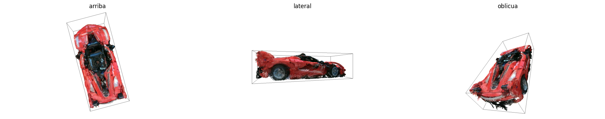
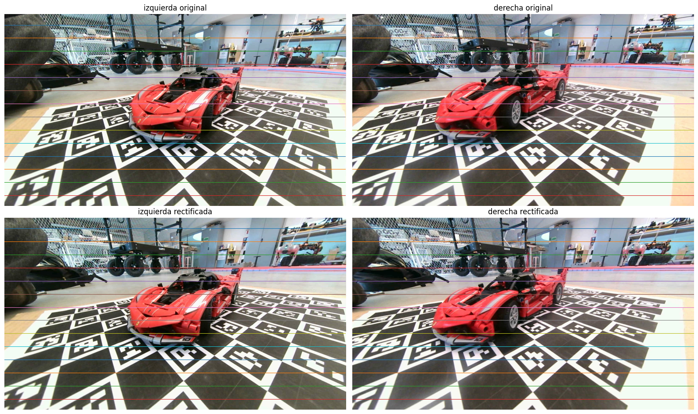
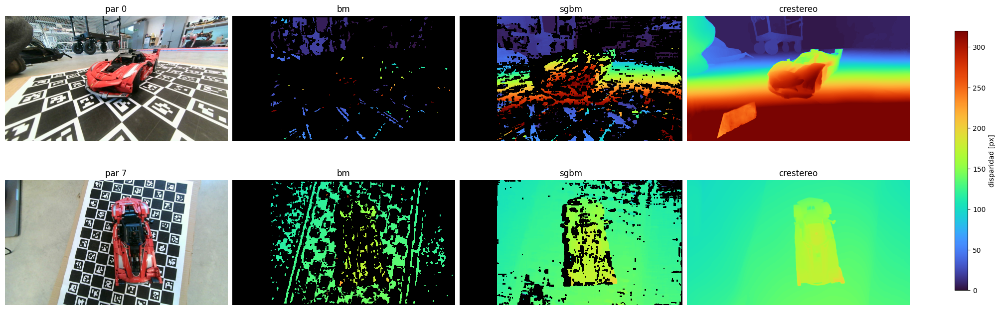
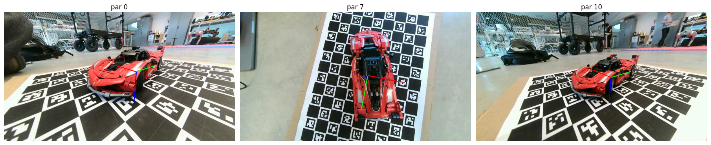
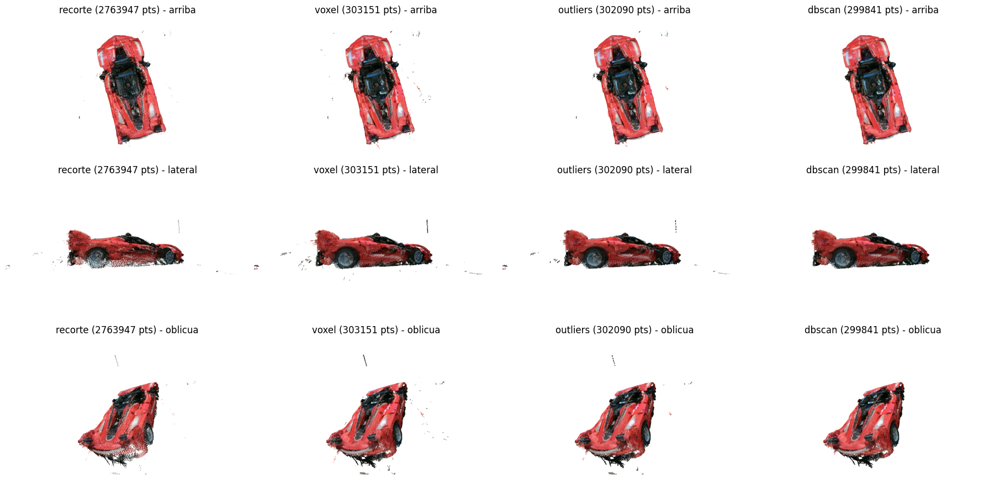

# Stereo 3D Reconstruction
### Reconstrucción y medición de un Ferrari de LEGO

Con un par de cámaras y fotos tomadas desde distintas posiciones, reconstruimos en 3D un auto de LEGO y medimos sus dimensiones reales en milímetros.

**García, González y Turkie** · Visión Artificial, UdeSA · octubre de 2026

[Informe](docs/informe.pdf) · [Notebook liviano](main_sin_salidas.ipynb) · [Nube de puntos final](ferrari.ply)

**Resultado:** una nube de casi 300 mil puntos del auto, con largo y alto medidos con menos de 1 % de error.

## Recorrido

### 1. Calibrar y rectificar las cámaras

Calibramos el par estéreo con 25 pares de fotos de un tablero ChArUco. Después rectificamos las imágenes: cada punto de la imagen izquierda queda a la misma altura que su correspondiente en la derecha, lo que convierte la búsqueda de coincidencias en un problema de una sola dimensión.

### 2. Estimar la profundidad

La disparidad (cuánto se desplaza cada punto entre las dos imágenes) da la profundidad. Comparamos dos métodos clásicos de OpenCV, StereoBM y SGBM, con CREStereo, una red preentrenada. Los clásicos dejan huecos en superficies lisas; CREStereo devuelve mapas mucho más completos.

### 3. Ubicar cada toma en el espacio

Con el tablero ChArUco y solvePnP estimamos la posición y orientación de la cámara en cada una de las 15 vistas. Así todas las nubes parciales se pueden expresar en un mismo sistema de coordenadas.

### 4. Unir las vistas y limpiar la nube

Fusionamos las nubes de todas las vistas y las procesamos con Open3D: recorte alrededor del auto, submuestreo por vóxeles, filtrado de outliers y DBSCAN para quedarnos con el objeto. De 2,7 millones de puntos pasamos a una nube limpia de unos 300 mil. También estudiamos el efecto de ICP para refinar la alineación.

### 5. Medir el auto

Medimos la nube con PCA en el plano del piso, descartando el 0,1 % de puntos en cada extremo:

| Dimensión | Medida | Referencia | Error |
| --- | ---: | ---: | ---: |
| Largo | 291,5 mm | 290,0 mm | +0,53 % |
| Ancho | 129,0 mm | 120,0 mm | +7,49 % |
| Alto | 79,9 mm | 80,0 mm | −0,10 % |

El mayor error aparece en el ancho. La medición verifica la nube entregada; no es una validación física independiente.

## Conclusión

Con un par de cámaras y un tablero impreso alcanzó para medir un objeto real con muy poco error en largo y alto. Los dos puntos que más cambiaron el resultado fueron la disparidad, donde CREStereo dejó muchos menos huecos que los métodos clásicos, y la limpieza de la nube. El ancho, con 7,5 % de error, queda como lo principal a mejorar.

## Revisar el resultado

La nube final se puede medir sin cámara ni modelos:

~~~sh
uv run --no-project --python 3.11.18 --with numpy==1.26.4 python scripts/medir_ply.py
~~~

La reconstrucción completa necesita OpenCV, Open3D y ONNX Runtime; el [entorno y los pasos](DOCUMENTACION.md) están documentados. El [notebook original](main.ipynb) conserva todas las salidas. Las bibliotecas, redes preentrenadas y ejemplos de la cátedra están identificados en la documentación.
